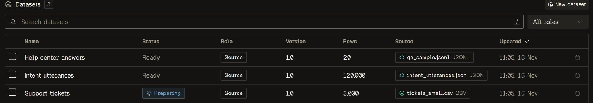

import { AgentPrompt } from "/snippets/agent-prompt.mdx";

Use this after the relevant [tutorial](/tutorials/index), or substitute a resource from your own project.

<AgentPrompt text="Inspect the fraud dataset we prepared in Overmind. Explain its source, available versions and intended uses, then identify the version ready for training and any unresolved preparation issues." />

## Identities

| Entity | Meaning |
| --- | --- |
| Dataset | Project-scoped brief, intent, optional capability and source/preparation history |
| Source | Retained original file or trace selection with extraction facts |
| Cell | Exact published rows, schema and fingerprint |
| Active version | Current default for a new consumer when no cell is supplied |
| Consumer pin | Exact cell retained for an evaluation, optimiser or training job |
| `source_row` | Source identity, independent of current display position |
| `_overmind_parent_rows` | Declared contributing source identities for externally imported derived rows |

Intent is `train` (with training format `sft` or `decision`), `eval`, or pending when not selected. Publication sets a pending intent from the final step's declared consumer. Each version reports whether its rows fit SFT training, decision training and evaluation. A capability is optional. Once a version has been used, the dataset’s intent and capability association are fixed. Selecting a different active version does not rewrite frozen consumers.

## Inventory and preparation

A dataset created in the Console with an intent or a brief starts the assistant once its source lands. The assistant prepares a version that fits the intent; with no intent it chooses the closest use and says which. A **Train + eval** split is prepared in one conversation, so both halves share the same cleaning steps. Each assistant publish first runs the script on a 200-row sample and publishes nothing when the sample fails.

The Console lists one row per source workspace: the source dataset and the outputs derived from it. Each row shows **Name**, **Role**, **Capability**, **Datapoints**, **Source** and **Updated**. **Role** is the intent: Train · SFT, Train · Decision, Train or Eval; a lock marks a dataset that a run or partition used, and its tooltip names the uses. A used dataset with no intent, such as the source of a split, shows its uses instead, for example Train + Eval. **Source** shows the first file and how many more, or Pasted rows, Inline rows, Traces, LLM calls, the version a dataset was derived from, or its split. Current work shows beside the name while it runs: upload bytes, rows written and measured while a source lands, and a transformation's stage with its completed batches or rows written and measured.

<Frame caption="The dataset inventory while the assistant prepares one dataset.">
  
</Frame>

The name shows Preparing while the [Console assistant](/how-to/use-assistant) works on the dataset. This comes from running work only; nothing labels a dataset between jobs.

## Source formats and limits

Read `overmind://dataset-upload` for the connected deployment's supported formats and numeric limits. Tables include CSV, TSV, JSON, JSONL/NDJSON and Parquet. Supported document/image landing retains original bytes and extraction metadata.

Current document limits are 100 MiB and 2,000 PDF pages. A transfer accepts up to 100 ordered files and 2 GiB combined, still subject to each file's limit. `--json-rows-field` explicitly selects a top-level JSON array for a single file.

PDF text recovery checks pages missed entirely by the primary parser before OCR. Tesseract OCR defaults to English; `update_dataset(ocr_languages=[...])` on a draft sets languages for subsequent imports, and `[]` restores the default. Retried imports retain their original settings.

Extraction records engines, languages, orientation and page regions where available. Font-encoding artifacts remain flagged rather than semantically repaired. OCR does not guarantee visual-table reconstruction or complete reading order.

## Inspection and query

`inspect_dataset` pages cells and source inventories independently. `source_limit` defaults to 10 and is at most 20; follow `source_page.next_cursor`, including when a response budget shortens a page.

`query_dataset` reads one exact cell through SQL. Current response bounds are 100 rows, 32 KiB JSON and 200 columns. Oversized results fail without clipping values. Project only required columns, aggregate or export the cell for larger work.

Mixed scalars and precision-sensitive integers are retained without lossy float conversion. Do not infer that text resembling JSON has become a structured value unless its schema declares that shape.

## Chat training

A trainable conversation retains message roles, content and tool-call structure, including supervised assistant targets. For example:

```json
{
  "messages": [
    {"role": "user", "content": "Classify: reset my password"},
    {"role": "assistant", "content": "account"}
  ]
}
```

Exact model preprocessing validates the selected tokenizer/template and supervised tokens. Format acceptance does not verify that the assistant response is correct.

## Evaluation

Generated-answer evaluation separates input from its reference:

```json
{
  "input": "Classify: reset my password",
  "expected_output": "account"
}
```

For `mode="recorded"`, the scorer uses a terminal assistant message when present, otherwise the row's retained `expected_output` as the recorded answer. It does not assume an arbitrary `output` column is the answer. A recorded answer cannot serve as independent evidence of its own correctness; use checks with valid evidence and inspect the pinned row contract.

## Typed decision training

```json
{
  "decision": {
    "state": "The account owner cannot sign in.",
    "question": "Which queue should receive this ticket?",
    "kind": "choice",
    "options": ["delivery", "account"],
    "target_probabilities": [0.1, 0.9]
  }
}
```

`choice` selects among options, `noul` uses false/true order and `score` uses ordered options. Distributions retain one finite probability per option and sum to one; positive example weights retain their contribution. Options can vary by example.

Mean-only ordinal supervision uses `target_mean`, increasing `option_values` and `target_semantics="ordinal_mean"`. It does not invent a probability distribution. Evidence-backed target semantics and provenance belong in retained code and metadata.

Final pipeline consumers are `chat_train`, `model_eval`, `decision_train` and `decision_eval`. Declare a nested decision column as `object`. Native evaluation projection keeps references outside `input.decision`.

## Trace sources

Trace selections retain recorded input/output, transcript, usage and score together. A source capability filter takes precedence over destination association. A unique matching invocation scopes the evidence; repeated matching invocations fail before publication. Unmatched sources retain whole-trace evidence without invented single-capability attribution.

Observed tool arguments do not replace missing wrapper input/output, and recorded answers do not become verified labels automatically.
